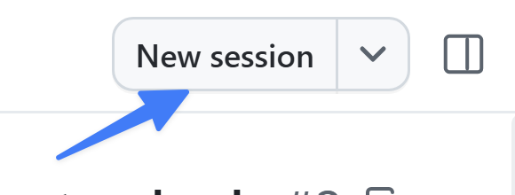

最初に、小さな機能をプロジェクトに追加しました。より大規模な変更には、さらに堅牢なプロセスが必要です。GitHub Copilot app は組織の既存のフローに沿って作業し、適切なものを適切な方法で構築できるようにします。このレッスンから数回にわたり、一般的なエージェント主導の開発プロセスを実践します。issue を使って新機能を作成し、コードが有効で機能が期待どおりに動作することを確認して、最終的にプロジェクトへマージします。

> [!NOTE]
> 機能の作業を続ける間、同じセッションを使用します。通常はファイルの種類ごとに異なるセッションやプルリクエスト (PR) を使いますが、ここでは主な概念に集中するため手順を簡略化します。

このレッスンでは、次のことを行います。

- GitHub issue からエージェントセッションを開始します。
- **Plan** モードで要件を定義します。
- **Autopilot** モードで新機能を実装します。
- コードをレビューします。
- ブラウザーキャンバスで機能を手動検証します。

機能の作業を続けながら、リポジトリの指示を更新し、既存の `quality-checks` スキルをカスタマイズし、MCP による検証を追加して QA エージェントを作成し、機能 PR を開きます。

## シナリオ

Tailspin Toys のカタログが増えているため、訪問者がカテゴリとパブリッシャーでゲームを絞り込めるようにします。バックログの issue には機能が記載されていますが、カテゴリを組み合わせる方法など、コーディング前に合意が必要な詳細があります。Plan モードで決定事項を整理し、範囲を定めた実装を Autopilot に任せます。

## 背景

AI コーディングエージェントを開発フローに導入しても基本は変わりません。むしろ、より重要になります。多くの開発者は、次のような流れで作業します。

1. 実装内容を記載した issue を開きます。
2. 構築する内容の計画を立てます。
3. コードを作成してレビューします。
4. テストを実行してコードを検証します。
5. 新機能を手動で検証します。
6. プルリクエスト (PR) を作成します。
7. コードのレビューと継続的インテグレーションが成功したら、コードをマージします。

> [!NOTE]
> 正確な手順はチームや組織によって異なりますが、ほとんどは上記の流れを調整したものです。

この標準的な進め方に従うことで、AI が生成したコードが要件を満たし、手作業で書いたコードと同じレビューと検証を受けるようにできます。

## セッションモード

**セッションモード**は、エージェントの自律性を制御します。プロンプト欄の下にあるドロップダウンで設定でき、いつでも変更できます。

- **Interactive**: 開発者とエージェントが協力します。エージェントは変更を提案し、続行前に入力を待ちます。
- **Plan**: エージェントが計画を作成します。実行前に計画をレビューして承認します。
- **Autopilot**: エージェントが自律的に作業し、入力を待たずにコードを書き、テストを実行して反復します。

まず Plan モードで計画を確認し、その後 Autopilot で実装します。

## issue からセッションを開始する

作業を始める前に、星評価の PR がマージされ、ローカルの `main` が最新であることを確認します。

1. サイドバーの **Sessions** で Tailspin Toys のリポジトリフォルダーを選択し、リポジトリ上部のナビゲーションで **Issues** を選択します。**Allow users to filter games by category and publisher** を開きます。テンプレートに含まれる issue のため、新しく作成する必要はありません。
2. **New session** を選択し、更新済みの `main` に基づく **new working tree** を選択します。

    

3. issue がセッションに添付されていることを確認し、モードセレクターで **Plan** を選択します。

> [!NOTE]
> Node.js または npm が見つからない場合は、エージェントに `node --version` と `npm --version` を実行するよう依頼します。ターミナルでは動作するのにセッションで動かない場合は、アプリの PATH またはバージョン管理ツールの設定を確認し、アプリを完全に終了して再起動します。失敗した操作とチェックを再試行してください。エージェントが npm を見つけられないという理由だけで再インストールしないでください。

## フィルタリング機能を計画する

Copilot がコードを書く前に計画を確認し、実装方法を決めます。issue から開始したため、Copilot は機能リクエストをすでに把握しています。計画の作成と確認は次の手順で行います。

1. 次のプロンプトを送信します。

   ```plaintext
   この機能を実装してください。
   ```

2. Copilot の質問に回答し、計画を issue の受け入れ条件に照らし合わせます。カテゴリとパブリッシャーのフィルタリング、アクセシブルなコントロール、データアクセスの変更、テストが含まれていることを確認します。
3. 複数カテゴリの組み合わせやゲームが見つからない場合の動作など、不明確な点を Copilot と話し合います。
4. 計画に、プロジェクトの既存ツールを使った lint、ユニットテスト、E2E テスト、型チェックが含まれていることを確認します。作業範囲がフィルタリングの実装とテストに絞られ、品質確認のワークフローが終わるまで PR を作成しないことも確認します。
5. 承認前に必要な修正を依頼します。後の検証に使えるよう、issue の URL と合意した明確化事項を控えます。

## Autopilot を明示的に承認する

計画を確認して承認し、Copilot が Autopilot モードで実装していることを確かめます。

1. 計画に問題がなければ **Approve and implement this plan**、または使用中のバージョンで表示される同等のオプションを選択します。
2. モードが自動で切り替わると思い込まず、モード表示が **Autopilot** になっていることを確認します。
3. Copilot が計画に沿ってコードを生成し、テストを実行しながら作業を繰り返す様子を確認します。

> [!NOTE]
> 承認するとすぐに実装が始まる場合があるため、先に計画を確認してください。依存関係が不足している、またはポートが競合していると Copilot が報告した場合は、チェック完了と判断する前にセットアップの問題を解決してください。自分が起動したサーバーだけを停止してください。

## 実装をレビューして検証する

生成されたコードは、ほかのコードと同様にマージ前にレビューします。コードを確認し、サイトを実行して動作も確かめましょう。

1. **Changes** を開き、フィルタリングの実装とテストを確認します。
2. 複数カテゴリやパブリッシャーの組み合わせも含め、結果を issue と承認した明確化事項に照らし合わせます。既存のリポジトリ指示に従っていることも確認します。
3. lint、ユニットテスト、E2E テスト、型チェックの結果を確認します。スキップされたチェックは成功ではありません。
4. 実装を承認する前に失敗を解消し、影響を受けるチェックを再実行します。Playwright の E2E 設定はプレビューをビルドして配信し、ローカルサーバーを再利用できます。以前のレッスンではなく、この worktree のサーバーがテストされていることを確認してください。

## 新機能を確認する

コードに問題がないように見えても、実際に動作することを確認します。Copilot にアプリを起動させ、ブラウザーキャンバスで開きます。

1. 次のプロンプトを送信します。

    ```plaintext
    アプリを起動して、ブラウザーキャンバスで開いてください。
    ```

2. しばらくするとアプリが起動し、Copilot app 内にブラウザーウィンドウが開きます。
3. カテゴリを選択し、結果が一致することを確認します。フィルターを解除してからパブリッシャーを選択し、結果を確認します。
4. カテゴリとパブリッシャーを組み合わせ、issue と承認済みの計画に照らして結果を確認します。複数カテゴリに対応する場合は、合意した組み合わせ動作を確認します。
5. ゲームが一致しない組み合わせを試し、空の状態を確認します。フィルターを解除またはリセットして、一覧全体に戻ることを確認します。
6. 確認が終わったら、次のプロンプトでこのセッションが起動した開発サーバーを停止します。

    ```plaintext
    開発サーバーを停止し、ブラウザーキャンバスを閉じてください。
    ```

## 次のレッスンでも同じセッションを使う

この時点ではフィルタリング PR を作成またはマージしないでください。レッスン 4 から 8 まで、このセッション、worktree、ブランチを使います。次はフィルタリングのコードにカスタム指示を適用し、スキルと QA の改善を追加してから、レッスン 8 で変更をまとめた PR を作成してマージします。開発サーバーを停止した後、セッションはそのままにして、次のレッスンで再開します。

## まとめと次のステップ

複数のエージェントモードを使って機能を構築し、レビューしました。このレッスンでは、次のことを行いました。

- GitHub issue からエージェントセッションを開始しました。
- **Plan** モードで要件を定義しました。
- **Autopilot** モードで新機能を実装しました。
- コードをレビューしました。
- ブラウザーキャンバスで機能を手動検証しました。

次は、[カスタム指示を使って][next-lesson]コードの生成方法をさらに詳しく確認し、文書化された規約に従うようにします。

## リソース

- [GitHub Copilot app でのエージェントセッションの操作][agent-sessions]

[next-lesson]: ../4-custom-instructions/
[agent-sessions]: https://docs.github.com/copilot/how-tos/github-copilot-app/agent-sessions
